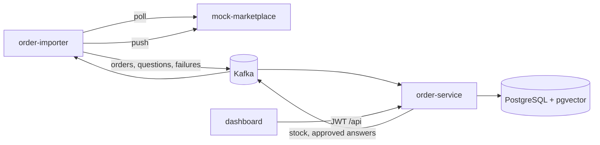

# PazarSync

PazarSync is two Spring Boot services that sync a marketplace. `order-importer` polls a Trendyol-like seller API and publishes orders and customer questions to Kafka. `order-service` stores each order once, decrements stock in that same transaction, and drafts a reply from past answers. A React dashboard shows sales, low stock, and failed syncs, and an operator approves each draft.



## Run it

Java on `PATH` may be 8. Builds use the Maven Wrapper, which reads `JAVA_HOME` (JDK 21).

```text
copy deploy\.env.example deploy\.env
docker compose -f deploy/docker-compose.yml up --build
```

- Dashboard: http://localhost:8080 — `admin` / `admin` (also `operator` / `operator`)
- API docs: http://localhost:8081/swagger-ui.html
- Mock seller API: http://localhost:8082

The mock emits orders and questions on a timer. After a poll, the overview chart, low-stock list, and question drafts fill in. Profiles are `dev,ai-stub`, so drafts are templated and no Gemini key is required.

To call Gemini instead, set `GEMINI_API_KEY` in `deploy/.env` and change the order-service profile to `dev,gemini`.

Without Docker, unit tests still run:

```text
.\mvnw.cmd -B test
cd dashboard
npm ci
npm run dev
```

The dev server proxies `/api` to `localhost:8081`. Integration tests use Testcontainers and start when Docker is running.

## Kubernetes

Build local images, enable Kubernetes in Docker Desktop, then apply the dev manifests. Postgres and Kafka are StatefulSets for that cluster only.

```text
docker build -f mock-marketplace/Dockerfile -t pazarsync/mock-marketplace:local .
docker build -f order-importer/Dockerfile -t pazarsync/order-importer:local .
docker build -f order-service/Dockerfile -t pazarsync/order-service:local .
docker build -f dashboard/Dockerfile -t pazarsync/dashboard:local .
kubectl apply -k deploy/k8s
```

## Design decisions

- An order is inserted with `ON CONFLICT (marketplace, external_order_id) DO NOTHING`. The stock decrement is in the same database transaction, and the Kafka offset is acknowledged only after that transaction commits. A redelivered event does not create a second order or a second decrement.
- The Kafka key is `marketplace:externalOrderId` (or the question id, or the barcode), with three partitions, so events for one order stay in order on one partition.
- Stock is locked with `SELECT … FOR UPDATE`. Ten parallel orders against five units leave the quantity at zero.
- A message that cannot be read is not retried. `DeadLetterPublishingRecoverer` sends it to `orders.received.DLT`, and that listener writes `sync_failures`. The dashboard retries a row by republishing its original payload.
- The mock returns HTTP 500 for about 10% of polls, can repeat an order in one page, and can be told to fail the first N calls. The importer retries with backoff, then publishes `sync.failures` and leaves the cursor where it was.
- Reply drafts use Spring AI. `ai-stub` embeds text locally and fills a template, which is what CI runs. `gemini` points the OpenAI starter at Gemini's OpenAI-compatible endpoint and stores past answers in pgvector.
- The importer and the order service use two databases on one Postgres instance so their Flyway histories do not collide.

## What only you can do

- Start Docker Desktop and, for the manifests, enable its Kubernetes.
- Put a Gemini API key in `deploy/.env` if you want live drafts.
- Create `github.com/EmreOzcanDev/PazarSync` and push. CI builds images and, on `main`, pushes them to GHCR.
- Follow [deploy/aws/README.md](deploy/aws/README.md) for the EC2 + RDS free-plan checklist. Set the billing alert first.

`docs/walkthrough.md` walks the code in interview order.
